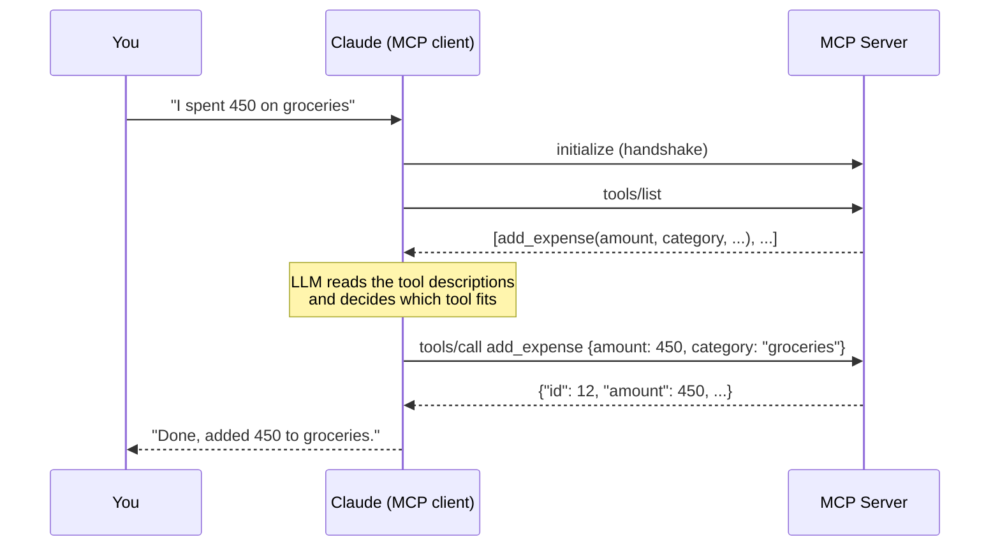
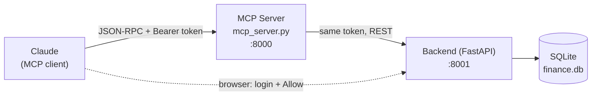
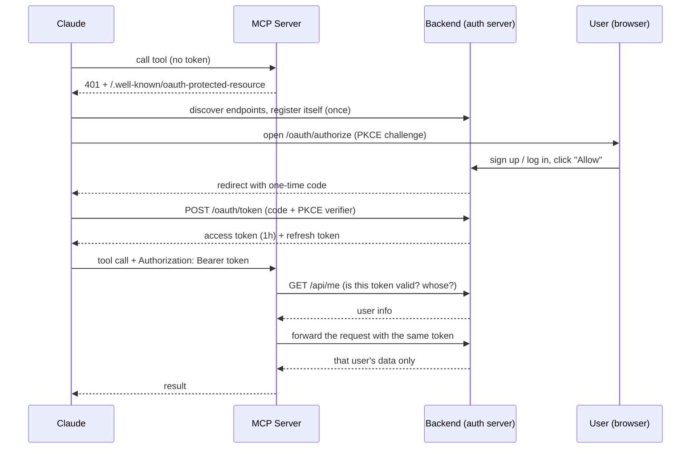

# Finance Tracker MCP

A personal finance tracker you use **by chatting**. Tell Claude *"I spent 450 on groceries"* and it is saved. Ask *"how am I doing on my food budget?"* and it answers from your real data.

It is also a **learning project for MCP** (Model Context Protocol): a small but complete example with real login (OAuth 2.1), multiple users and a database. Read it, run it, fork it.

---

## 1. What is MCP?

An LLM like Claude can only talk. **MCP is a standard way to give it hands**: tools it can call, such as "add an expense".

| Term | Meaning | Here |
|---|---|---|
| **Host / Client** | The app with the LLM that calls tools | Claude |
| **MCP Server** | A program that exposes tools | `mcp_server.py` |
| **Tool** | A function: name + description + typed arguments | `add_expense`, `monthly_summary`, ... |
| **Transport** | How client and server talk | Streamable HTTP (`/mcp`) |
| **Protocol** | The message format | JSON-RPC 2.0 |

### How a tool call works internally



Key ideas:
- **Tools are self-describing.** In FastMCP the *docstring* becomes the description the LLM reads, and the *type hints* become the input schema. Good docstrings = better tool use.
- **The LLM decides, the server executes.** The server never talks to the user; it only answers tool calls.
- **Everything is JSON-RPC.** `tools/list` and `tools/call` are plain JSON messages over HTTP.

---

## 2. Architecture

Two separate processes. The MCP server is a **thin, stateless wrapper**. All data and logic live in the backend.



| Part | File(s) | Job |
|---|---|---|
| MCP server | `mcp_server.py` | Exposes 6 tools, forwards each call to the backend |
| Backend | `backend/` | REST API, database, **and** the OAuth login server |
| Tests | `test_oauth_flow.py` | End-to-end script that pretends to be Claude |

Backend layering: `routes` → `services.py` (all SQL/business rules) → `models.py` (SQLAlchemy).

### The 6 tools

| Tool | Example prompt |
|---|---|
| `add_expense` | "I spent 450 on groceries" |
| `list_expenses` | "Show my expenses this month" |
| `delete_expense` | "Delete expense 12" |
| `monthly_summary` | "Summarize October by category" |
| `set_budget` | "Budget 5000 for food" |
| `budget_status` | "Am I over budget anywhere?" |

---

## 3. How login works (OAuth 2.1)

A public MCP server needs to know **who** is calling so each user sees only their own data. MCP uses OAuth: the MCP server is the *resource server*, and our backend is the *authorization server*.



Security features: PKCE (S256) required, exact redirect-URI matching, single-use auth codes, rotating refresh tokens, tokens stored only as SHA-256 hashes, CSRF protection on forms.

---

## 4. Run it

Needs Python 3.12+.

```bash
git clone <your-fork-url>
cd finance_tracker
pip install -r requirements.txt

cp .env.example .env        # then set SECRET_KEY (command is inside the file)

# terminal 1: backend
uvicorn backend.main:app --port 8001 --reload     # API docs: http://127.0.0.1:8001/docs

# terminal 2: MCP server
python mcp_server.py                              # endpoint: http://127.0.0.1:8000/mcp
```

Verify everything works (both servers must be running):

```bash
python test_oauth_flow.py
```

### Try it without Claude: MCP Inspector

```bash
npx @modelcontextprotocol/inspector
```
Choose **Streamable HTTP**, URL `http://127.0.0.1:8000/mcp`, then browse and call the tools.

### Connect to Claude

1. Claude does not accept a purely local URL for remote connectors, so expose both servers publicly (for example a tunnel such as ngrok, or deploy them).
2. Set `BASE_URL`, `PUBLIC_BACKEND_URL` and `PUBLIC_MCP_URL` in `.env` to the public addresses.
3. In Claude: **Settings → Connectors → Add custom connector** and paste your `https://.../mcp` URL.
4. A browser tab opens: sign up, log in, click **Allow**. Then just chat.

---

## 5. Project layout

```
finance_tracker/
├── mcp_server.py        # MCP server: tools + token verification (start reading here)
├── backend/
│   ├── main.py          # FastAPI app
│   ├── oauth_routes.py  # OAuth: register, authorize, token, revoke
│   ├── finance_routes.py# /api/* endpoints (bearer token)
│   ├── web_routes.py    # signup / login / dashboard pages (session cookie)
│   ├── services.py      # all business logic + SQL
│   ├── models.py        # database tables
│   ├── security.py      # hashing, tokens, PKCE
│   └── templates/       # HTML pages
├── test_oauth_flow.py   # end-to-end test
└── .env.example         # configuration
```

(The parent folder also has `server.py`, a minimal stdio/HTTP MCP server with no auth. It is the simplest starting point if you are brand new.)

---

## 6. Learn by modifying it

**Add your own tool** (e.g. `edit_expense`):
1. Add a function in `backend/services.py` (always filter by `user_id`).
2. Add a route in `backend/finance_routes.py`.
3. Add a thin wrapper in `mcp_server.py`:

```python
@mcp.tool()
@logged
async def my_tool(arg: str) -> dict:
    """Clear description. The LLM reads this to decide when to call the tool."""
    return await call_backend("GET", "/api/my-route", params={"arg": arg})
```

**Things worth remembering**
- Money is stored as integer paise, never floats.
- Every service query must filter by `user_id`; that is what isolates users.
- Never `print()` in an MCP server that may use stdio; use `logging` (stderr).
- Tables are auto-created; there are no migrations, so changing a model does not alter an existing `finance.db`.

## 7. Tech stack

Python · [MCP Python SDK (FastMCP)](https://github.com/modelcontextprotocol/python-sdk) · FastAPI · SQLAlchemy 2 · SQLite (Postgres-ready) · Jinja2 · httpx

## Further reading

- [modelcontextprotocol.io](https://modelcontextprotocol.io): the official spec and docs
- [MCP authorization spec](https://modelcontextprotocol.io/specification/latest/basic/authorization)
